<div align="center">



<br>


<br>

<a href="https://app.hackthebox.com/public/users/2809489">
  
</a>

</div>


<div align="center">

### 🏯 Operator Profile

</div>

```
┌─ whoami ─────────────────────────────────────────────────────────┐
│ name     : Resego Mokgopa                                        │
│ handle   : r4gn4rock / Cyb3rM0n4rch                              │
│ role     : Penetration Tester · SOC Analyst (pivoting)           │
│ focus    : web app security · network security · detection       │
│ status   : CPTS (in progress) · BSCP (in progress)               │
│ drive    : hands-on labs, CTFs, and security tooling             │
└──────────────────────────────────────────────────────────────────┘
```

<div align="center">

**Interests:** Web application security · Network security · Vulnerability assessment · Incident detection · Offensive security

</div>


<div align="center">

### 📜 Bushido Code

> *"Know your enemy, know yourself, and in a hundred battles you will never be in peril."*
> — Sun Tzu

**義 Gi** Justice &nbsp;·&nbsp; **勇 Yū** Courage &nbsp;·&nbsp; **礼 Rei** Respect &nbsp;·&nbsp; **誠 Makoto** Honesty

</div>


<div align="center">

### 🗡️ Security Arsenal

<table>
<tr>
<td align="center" width="33%"><b>⚔️ Offensive</b><br><br>
<br>
<br>
<br>
<br>
<br>
<br>
<br>

</td>
<td align="center" width="33%"><b>🛡️ Blue Team</b><br><br>
<br>
<br>
<br>
<br>
<br>

</td>
<td align="center" width="33%"><b>🐍 Tooling</b><br><br>
<br>
<br>
<br>
<br>
<br>

</td>
</tr>
</table>

</div>


<div align="center">

### 🏯 Featured Operations

</div>

<div align="center">

| Project | Description | Stack |
|---|---|---|
| [Python Password Strength Checker](https://github.com/Cyb3rM0n4rch/python-password-strength-checker) | Analyzes password strength and flags weak credentials | Python |
| [Home SOC Automation](https://github.com/Cyb3rM0n4rch/YOUR-REPO) | Automated detection and response workflows for a home SOC | Python · Bash |
| [Home SOC Lab:ELK Stack](https://github.com/Cyb3rM0n4rch/YOUR-REPO) | Centralized log ingestion, search, and security dashboards,   Elasticsearch · Logstash · Kibana |
| [Python IOC Extractor](https://github.com/r4gn4rock/Python_ioc_Xtractor) | Extracts indicators of compromise (IPs, domains, hashes) from text | Python |

</div>


<div align="center">

### 📊 Telemetry


&nbsp;&nbsp;
<a href="https://git.io/streak-stats"></a>

<br><br>


</div>


<div align="center">

### 📫 Connect

<a href="https://www.linkedin.com/in/resego-mokgopa"></a>
<a href="https://app.hackthebox.com/public/users/2809489"></a>
<a href="mailto:rbmokgopa01@gmail.com"></a>

<br><br>


<br><br>

*"The warrior who knows the path needs no fear of the end."*

</div>
